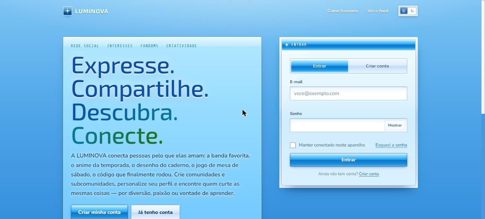

# LumiNova

Rede social brasileira para pessoas que querem se conectar por interesses em comum: fandoms, música, desenho, jogos, programação. A plataforma se organiza em **comunidades e subcomunidades** e tem chat em tempo real, perfis personalizáveis e um sistema de progressão com XP, conquistas e árvore de habilidades.

**Demonstração:** [luminova-cwgc.onrender.com](https://luminova-cwgc.onrender.com) · **Versão:** 4.1.0 · **Autora:** [Lívia Vittoria](https://github.com/liviavittoria28-create)

| Tema claro | Tema escuro |
|---|---|
|  |  |

---

## Objetivo

Criar um espaço em que a conversa começa pelo interesse, e não pelo número de seguidores. Cada assunto tem sua comunidade, e cada comunidade pode se dividir em subcomunidades com regras próprias.

## Problema que resolve

Nas redes generalistas, quem gosta de um tema de nicho fica perdido num feed único, misturado com todo o resto. A LumiNova separa o conteúdo por comunidade e subcomunidade e mostra o que é recente ou está em alta em cada uma. O sistema de progressão incentiva a participação: publicar, colaborar e explorar comunidades.

## Funcionalidades

| Área | O que existe |
|---|---|
| Contas | Cadastro, login com "manter conectado", recuperação e redefinição de senha (Supabase Auth) |
| Feed geral | Abas Recentes e Em alta, tópico do dia, hashtags do momento, publicações salvas, leitura como visitante |
| Comunidades | Criação com capa, avatar, descrição e regras; o limite de comunidades por pessoa aumenta com o XP |
| Subcomunidades | Feed próprio; membros podem encaminhar um post da comunidade principal para uma sub |
| Chats | Conversas diretas e chat de comunidade em tempo real (Supabase Realtime) |
| Perfis | Perfil público, seguir e deixar de seguir, personalização visual (cores, capa, widgets) |
| Progressão | XP, níveis, 14 conquistas e *Skill Tree* com 22 nós em 4 ramos; o resgate é validado no banco |
| Moderação | Denúncias, bloqueio de usuários e painel de administração |
| Privacidade (LGPD) | Registro de consentimentos, download dos próprios dados em JSON, exclusão definitiva da conta, Termos e Política de Privacidade |
| Interface | Tema claro e escuro, layout responsivo |

## Tecnologias

| Camada | Tecnologia |
|---|---|
| Front-end | HTML5, CSS3 e JavaScript puros, sem framework nem etapa de build |
| Back-end | Supabase: Auth, PostgREST, Storage e Realtime |
| Banco de dados | PostgreSQL com Row Level Security, funções `security definer` e triggers |
| Testes | SQL contra Postgres 16 local; script Node.js para testar a API REST |
| Hospedagem | Render (site estático) |

## Arquitetura

```
Navegador (HTML/CSS/JS)
   │  supabase-js com a chave pública (publishable)
   ▼
Supabase ── Auth (sessão) ── Realtime (chats) ── Storage (imagens e arquivos)
   │
   ▼
PostgreSQL
   ├─ RLS ativado nas 49 tabelas do schema public (123 políticas)
   ├─ funções para regras que o navegador não pode decidir:
   │    resgate da Skill Tree, encaminhamento de posts, limites de comunidade
   └─ triggers de XP, notificações, proteção contra escalada de papel
      e limite de frequência para posts, comentários, mensagens e denúncias
```

Não existe servidor próprio: o site é estático, e tudo que precisa ser confiável fica no banco. A chave em `Frontend/supabase-config.js` é a *publishable key*, feita para uso no navegador. A `service_role` nunca vai para o front-end.

**Destino de cada publicação**

| Destino | Registro no banco | Onde aparece |
|---|---|---|
| Feed geral | `posts` sem linha em `community_posts` | só no feed geral |
| Comunidade | `community_posts` com `subcommunity_id` nulo | só no feed da comunidade |
| Subcomunidade | `community_posts` com `subcommunity_id` | só no feed daquela sub |
| Encaminhamento | `community_post_forwards` | na sub, citando o post original |

## Estrutura de pastas

```
Frontend/                  site publicado (uma página = um .html + um .js)
  index.html               página inicial e login
  geral.html               feed geral
  comunidades.html         lista e criação de comunidades
  comunidade-detalhe.html  feed, membros e subcomunidades
  chats.html               mensagens em tempo real
  perfil.html              perfil e personalização
  configuracoes.html       conta, privacidade e dados (LGPD)
  admin.html               moderação
  luminova-sidebar.js      núcleo: cliente Supabase, sessão e menu lateral
  luminova-theme.js        tema claro/escuro
  supabase-config.js       URL do projeto, chave pública e versão
Banco de Dados/
  Banco de dados.sql       schema base
  Migracao-*.sql           migrações numeradas
  testes/                  testes SQL e de API
Backend/
  versionar-assets.js      aplica ?v=<versão> nos .js e .css (cache busting)
docs/
  LEIA-PRIMEIRO.md         notas técnicas detalhadas
```

## Como executar

**Pré-requisitos:** uma conta no [Supabase](https://supabase.com) e qualquer servidor de arquivos estáticos.

1. Crie um projeto no Supabase.
2. No **SQL Editor**, rode os scripts de `Banco de Dados/` nesta ordem:
   `Banco de dados.sql` → `Migracao-completa-LUMINOVA.sql` → `Migracao-2` → `3` → `4` → `5` → `6` → `9` → `10` → `11`.
3. Em **Authentication → URL Configuration**, cadastre a URL do site e os redirecionamentos para `/boas-vindas.html` e `/redefinir-senha.html`.
4. Edite `Frontend/supabase-config.js` com a URL e a chave pública do seu projeto.
5. Sirva a pasta `Frontend/`:
   ```bash
   npx serve Frontend
   ```

### Configuração

O projeto não usa arquivo `.env`, porque não há servidor. As duas configurações ficam em `Frontend/supabase-config.js`:

| Campo | Descrição |
|---|---|
| `url` | URL do projeto Supabase |
| `anonKey` | chave pública (*publishable/anon*) do projeto |

Depois de mudar `LUMINOVA_VERSION`, rode `node Backend/versionar-assets.js` para atualizar o cache dos navegadores.

## Banco de dados e migrations

- O schema base está em `Banco de dados.sql`, e as mudanças posteriores, nas migrações numeradas.
- As migrações são idempotentes: podem rodar mais de uma vez sem apagar dados.
- `Remover-mentor-matching-OPCIONAL.sql` remove tabelas de um recurso antigo de mentoria. É opcional.
- `testes/50-dados-visuais.sql` cria dados **fictícios** apenas para o banco local. Não deve ser executado no Supabase.

## Testes

Os testes SQL rodam num Postgres 16 local com um *stub* dos esquemas do Supabase (`auth`, `storage`, papéis `anon` e `authenticated`). Resultado da última execução: **81 de 81 aprovados**.

| Arquivo | Testes | O que verifica |
|---|---:|---|
| `10-ataques-rls.sql` | 17 | tentativas de ler ou alterar dados de outra pessoa |
| `20-funcionalidades.sql` | 33 | posts, comentários, comunidades, chat, perfil |
| `25-posts-de-comunidade.sql` | 10 | em qual feed cada publicação aparece |
| `27-subcomunidades.sql` | 13 | subcomunidades e encaminhamento |
| `28-skill-tree.sql` | 8 | regras de desbloqueio da árvore de habilidades |

```bash
# requer um container Postgres chamado lumi-pg (ou defina PG_CONTAINER)
bash "Banco de Dados/testes/aplicar.sh" --reset
bash "Banco de Dados/testes/rodar-testes.sh"
```

## Limitações conhecidas

- Não há testes automatizados de interface. Os testes cobrem o banco de dados e as regras de acesso.
- Os buckets de Storage (`community-media` e `profile-media`) são públicos: quem tiver a URL de um arquivo consegue abri-lo.
- Os arquivos JavaScript e CSS são servidos sem minificação.
- A coluna de anúncios existe no layout, mas ainda não tem anunciantes.

## Melhorias futuras

- Testes de interface (end-to-end) dos fluxos principais.
- Buckets privados com URLs assinadas para mídia de comunidades fechadas.
- Etapa de build para minificar e agrupar os assets.
- Busca de texto completo nas publicações.

---

Desenvolvido por **Lívia Vittoria** · [Portfólio](https://liviavittoria28-create.github.io) · [LinkedIn](https://www.linkedin.com/in/livia-vittoria-732b8a430/)
