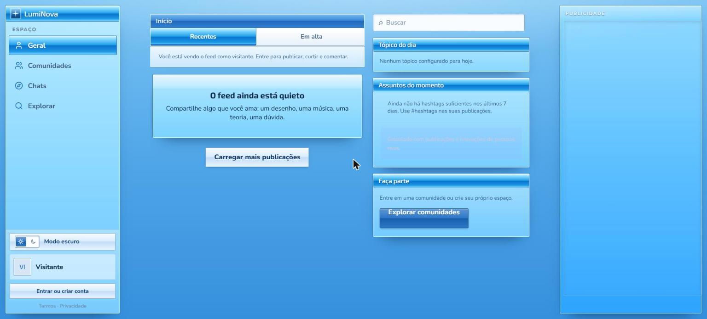

# LumiNova

Rede social brasileira para quem quer encontrar gente que gosta das mesmas coisas: fandoms, música, desenho, jogos, programação. Em vez de um feed único, a LumiNova se organiza em **comunidades e subcomunidades**, com chat em tempo real, perfis personalizáveis e um sistema de progressão (XP, níveis, conquistas e uma árvore de habilidades).

**Demo:** [luminova-cwgc.onrender.com](https://luminova-cwgc.onrender.com) · versão 4.1.0


## Funcionalidades

- **Contas:** cadastro, login com "manter conectado", recuperação e redefinição de senha (Supabase Auth).
- **Feed geral:** abas Recentes e Em alta, tópico do dia, hashtags em alta, publicações salvas. Visitantes podem ler o feed sem conta.
- **Comunidades e subcomunidades:** cada uma com capa, avatar, descrição e regras. Uma publicação pertence ao feed geral, a uma comunidade ou a uma subcomunidade. Membros podem encaminhar um post da comunidade principal para uma sub.
- **Chats:** conversas diretas e chat de comunidade, atualizados em tempo real (Supabase Realtime).
- **Perfis:** página pública, seguir/deixar de seguir, personalização visual do perfil.
- **Progressão:** XP, níveis e conquistas calculados no banco, além de uma *Skill Tree* com 22 nós em 4 ramos (Criação, Colaboração, Comunidade, Exploração). O resgate de cada nó é validado por uma função no Postgres, e não pelo navegador.
- **Notificações**, denúncias e bloqueio de usuários.
- **Privacidade (LGPD):** registro de consentimentos, download dos próprios dados em JSON, exclusão definitiva da conta, páginas de Termos de Uso e Política de Privacidade.
- **Tema claro e escuro.**
- **Painel de administração** para moderação.



## Tecnologias

| Camada | O que é usado |
|---|---|
| Front-end | HTML, CSS e JavaScript puros (sem framework nem build) |
| Back-end | Supabase: Auth, Postgres, Storage e Realtime |
| Banco | PostgreSQL com **Row Level Security** em todas as tabelas (mais de 120 políticas) e funções `security definer` para as regras de negócio |
| Hospedagem | Render (site estático) |

## Arquitetura

O site é estático: cada página tem seu `.html` e, quando precisa, um `.js` com o mesmo nome. Não existe servidor próprio. Toda regra que não pode ser burlada pelo navegador (quem lê o quê, resgate de XP, encaminhamento de posts, limites de comunidade) fica no Postgres, em políticas RLS, triggers e funções.

```
Frontend/            site publicado
  luminova-sidebar.js  núcleo compartilhado: cliente Supabase, sessão, menu lateral
  luminova-theme.js    tema claro/escuro
  supabase-config.js   URL do projeto e chave pública (publishable)
Banco de Dados/      schema, migrações numeradas e testes
  testes/              testes SQL de segurança e de funcionalidade
Backend/
  versionar-assets.js  cache-busting (?v=<versão>) nos .js/.css
docs/
  LEIA-PRIMEIRO.md     notas técnicas detalhadas
```

A chave em `supabase-config.js` é a *publishable key*, feita para ficar no navegador. A proteção dos dados vem das políticas RLS. A `service_role` key nunca entra no front-end.

## Testes

São **81 testes SQL** que rodam contra um Postgres 16 local com um *stub* dos esquemas do Supabase (`auth`, `storage` e papéis `anon`/`authenticated`):

| Arquivo | Testes | O que cobre |
|---|---|---|
| `10-ataques-rls.sql` | 17 | tentativas de ler ou alterar dados de outra pessoa |
| `20-funcionalidades.sql` | 33 | fluxos principais: posts, comentários, comunidades, chat, perfil |
| `25-posts-de-comunidade.sql` | 10 | em qual feed cada publicação aparece |
| `27-subcomunidades.sql` | 13 | subcomunidades e encaminhamento de posts |
| `28-skill-tree.sql` | 8 | regras de desbloqueio da árvore de habilidades |

```bash
bash "Banco de Dados/testes/aplicar.sh" --reset   # cria o banco luminova_test e aplica schema + migrações
bash "Banco de Dados/testes/rodar-testes.sh"
```

Os scripts esperam um container Docker chamado `lumi-pg` (variável `PG_CONTAINER`).

## Como rodar localmente

1. Crie um projeto no [Supabase](https://supabase.com).
2. No SQL Editor, rode os arquivos de `Banco de Dados/` na ordem descrita em [`docs/LEIA-PRIMEIRO.md`](docs/LEIA-PRIMEIRO.md).
3. Em `Frontend/supabase-config.js`, troque `url` e `anonKey` pelos dados do seu projeto.
4. Sirva a pasta `Frontend/` com qualquer servidor estático:
   ```bash
   npx serve Frontend
   ```
5. No Supabase Auth, cadastre a URL do site e os redirecionamentos para `/boas-vindas.html` e `/redefinir-senha.html`.

## Autora

Desenvolvido por **Lívia Vittoria** · [GitHub](https://github.com/liviavittoria28-create)
